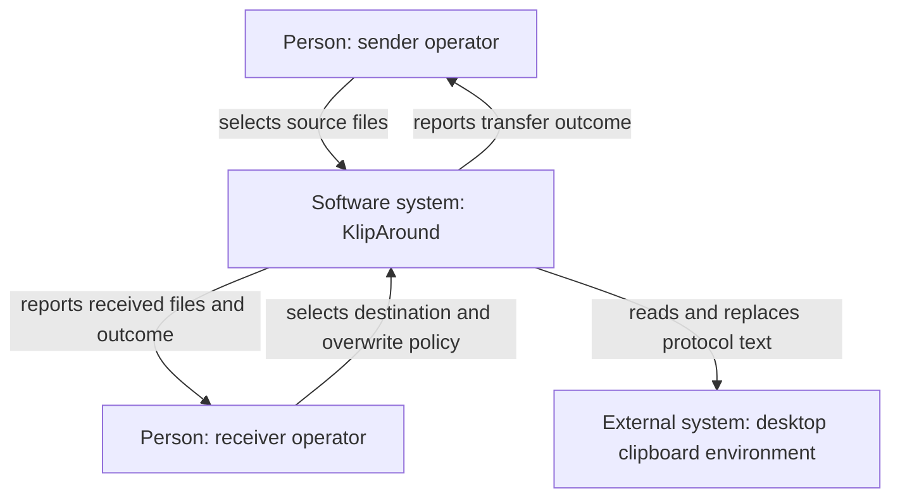
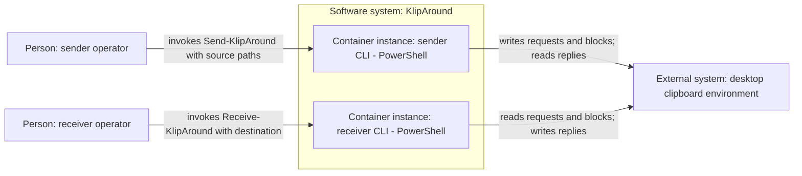
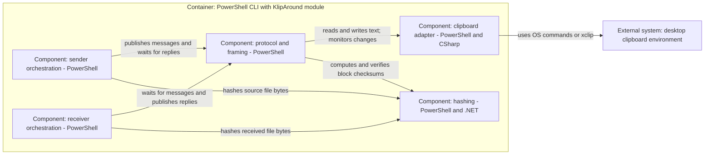
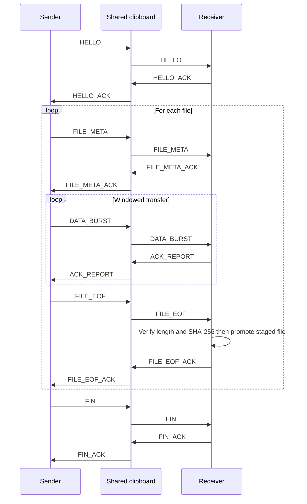
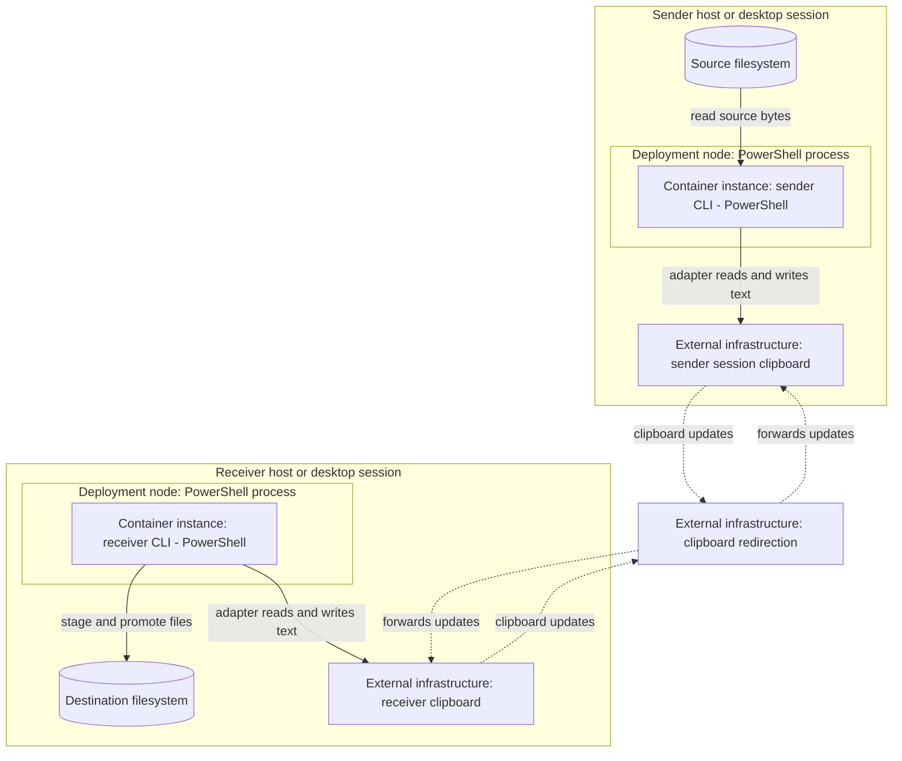

# KlipAround architecture

This document describes the implemented architecture of KlipAround 1.0.1
using the [arc42](https://arc42.org/) structure. It is based on the source,
tests, [README](../README.md), and [architectural decision records](decisions/README.md).
Where the project has no documented target or guarantee, none is assumed.

The context, container, component, and deployment diagrams use
[C4](https://c4model.com/) abstractions in Mermaid, not a separate model or
diagram generator. Labels identify element types and technologies; arrows
name relationships, not execution order. Each view is scoped below. There
is no code-level diagram because source links provide the needed detail.

## 1. Introduction and goals

### 1.1 Requirements overview

KlipAround transfers one or more files between two concurrently running
PowerShell sessions that share a text clipboard, including clipboard-enabled
Remote Desktop sessions. Operators need to detect failed transfers, preserve
existing destination files unless they authorize replacement, and install the
module when network access is unavailable. The module also provides transport
diagnostics and a local performance benchmark.

### 1.2 Quality goals

| Goal | Operator or maintainer expectation |
| --- | --- |
| Integrity and safety | Reject invalid blocks and unverified files; preserve an existing destination until a replacement is verified. |
| Reliability | Tolerate temporary clipboard disruption and report when a transfer cannot complete. |
| Portability | Transfer files on the supported Windows and Linux configurations. |
| Offline deployability | Install the module from a self-contained script without Internet or a file share. |
| Operability | Surface timeout and clipboard errors and provide progress, verbose diagnostics, and repeatable tests. |

The goals are listed in suggested priority order inferred from the project, not
as stakeholder-approved priorities or measured service-level objectives. See
[quality scenarios](#10-quality-requirements).

### 1.3 Stakeholders

| Stakeholder | Concern |
| --- | --- |
| Sender and receiver operators | Transfer files safely between clipboard-connected sessions. |
| Offline installer operator | Install the module in an appropriate scope without network access. |
| Maintainers and contributors | Understand protocol compatibility, platform differences, tests, and releases. |
| Gallery publisher | Produce and publish an identifiable package with documentation and license metadata. |

## 2. Architecture constraints

* The clipboard is a shared, text-based, effectively half-duplex channel; other
  applications or users can overwrite its contents.
* The clipboard's text capacity and update timing vary by environment.
* The runtime module targets Windows PowerShell 5.1 and PowerShell 7; Linux
  support requires PowerShell 7, `xclip`, and an accessible X11 or XWayland
  display. Native Wayland-only and headless sessions without that clipboard
  are unsupported.
* Building a Gallery package requires Git and PowerShell with
  Microsoft.PowerShell.PSResourceGet 1.1.0 or later. These are build-time
  dependencies, not prerequisites for running the installed module.

See [section 11](#11-risks-and-technical-debt) for limitations of the current
design, including protocol compatibility and the lack of resume.

## 3. System scope and context

### 3.1 Business context

**C4 system context:** KlipAround is one software system with two operator
roles. Its external clipboard environment supplies the communication channel.
Files are inputs and outputs, not additional applications in this view.

<!-- mermaid-checked: no \n, no em-dash/en-dash, no {} in labels, subgraphs are id["label"], arrows are -->|"label"|, all subgraphs closed by end, ids unique -->

The KlipAround box represents the file-transfer system as a whole, not a
server. The clipboard environment includes OS clipboard services and any
redirection product; it is outside KlipAround's ownership. Package publishing
and installation are shown separately in [section 7](#7-deployment-view).

### 3.2 Technical context

| External interface | Use |
| --- | --- |
| PowerShell caller | Invokes public functions directly or supplies sender paths through the pipeline. |
| Filesystem | Reads source files; creates, verifies, and promotes received files; stores packages and installers. |
| Shared text clipboard | Carries protocol v2 requests, file blocks, and replies. The endpoints take turns writing and reading text, locally or through external clipboard redirection. |
| Windows clipboard | Uses PowerShell clipboard commands and, when available, a Windows Forms clipboard change listener. |
| Linux X11 clipboard | Invokes `xclip` directly with bounded subprocess operations; polling detects changes. |
| PowerShell Gallery | Distribution source and publishing destination; not needed by offline bootstrap installation. |
| GitHub | Source repository and tagged documentation target referenced by package metadata. |

## 4. Solution strategy

| Goal or constraint | Strategy and rationale |
| --- | --- |
| Reliability on a shared clipboard ([Q1](#q1-reliability)) | Use separate sender and receiver roles with turn-taking, sequenced bursts, and bounded retries. Selective retransmission avoids resending data the receiver already has. Marked JSON and a single Base64 layer carry binary data as text without a second encoding overhead. [ADR 0001](decisions/0001-use-half-duplex-clipboard-transport.md), [0005](decisions/0005-retry-and-acknowledge-transfer-messages.md), [0006](decisions/0006-use-versioned-single-base64-framing.md). |
| Integrity and safety ([Q2](#q2-integrity-and-safety), [Q3](#q3-probe-safety)) | Verify blocks and whole files, stage output to protect the destination, and require explicit consent for a diagnostic that overwrites clipboard contents. [ADR 0004](decisions/0004-validate-and-stage-received-files.md), [0010](decisions/0010-require-consent-for-clipboard-probes.md). |
| Portability ([Q5](#q5-portability)) | Keep platform-specific clipboard access behind a common interface so the transfer protocol is shared. Windows can use a listener or polling; Linux uses `xclip`. [ADR 0002](decisions/0002-use-windows-clipboard-listener-with-polling-fallback.md), [0003](decisions/0003-use-xclip-for-linux-clipboard.md). |
| Offline deployability ([Q4](#q4-offline-installation)) | Ship the same module through a staged Gallery package or a self-contained script for endpoints that cannot reach the Gallery. [ADR 0008](decisions/0008-generate-offline-bootstrap-installers.md), [0009](decisions/0009-build-isolated-gallery-packages.md). |
| Operability ([Q6](#q6-operability)) | Surface clipboard failures instead of silently switching to a process-local clipboard. Keep diagnostics explicit and exercise failure paths in CI. [ADR 0003](decisions/0003-use-xclip-for-linux-clipboard.md), [0011](decisions/0011-validate-supported-platforms-in-ci.md). |

## 5. Building block view

### 5.1 C4 container view

In C4, a container is an application or data store, not necessarily a Docker
container. KlipAround is a module loaded into a PowerShell command-line
application. The view shows two instances of that same application in sender
and receiver roles, not two separately shipped products. Both are inside the
system boundary; the desktop clipboard environment is outside it.

<!-- mermaid-checked: no \n, no em-dash/en-dash, no {} in labels, subgraphs are id["label"], arrows are -->|"label"|, all subgraphs closed by end, ids unique -->

The channel carries [protocol v2](protocol-v2.md) marked JSON text with Base64
file blocks. Source files are read by the sender instance; destination files
are staged and promoted by the receiver instance. These filesystem resources
are mapped to endpoint environments in [section 7](#71-transfer-endpoints),
rather than modeled as independent application services. Gallery access is
not part of transfer execution.

### 5.2 C4 component view

**Scope:** the transfer-related components of the PowerShell CLI container.
Both instances load the same module. Only the command matching the instance's
role orchestrates a given transfer; showing both commands here describes the
available code, not a single process running both ends.

<!-- mermaid-checked: no \n, no em-dash/en-dash, no {} in labels, subgraphs are id["label"], arrows are -->|"label"|, all subgraphs closed by end, ids unique -->

Arrows are runtime dependencies. The inventory also lists the loader,
diagnostics, and bootstrap generator, which are outside this diagram's
transfer-focused scope. Import makes commands available; it does not invoke
them. The benchmark orchestrates local sender/receiver execution rather than
adding another production service.

| Building block | Responsibility | Important interface | Implementation |
| --- | --- | --- | --- |
| Module entry | Discover private/public scripts and export functions and aliases. | Module import and exported commands. | [KlipAround.psd1](../KlipAround.psd1), [KlipAround.psm1](../KlipAround.psm1) |
| Sender | Negotiate a session, send blocks, and retry. Existing literal paths take precedence over wildcard expansion. | Command or pipeline input for source paths; v2 messages and acknowledgments. | [Send-KlipAround.ps1](../Public/Send-KlipAround.ps1) |
| Receiver | Accept a session, validate metadata and blocks, stage files, and acknowledge completion. | Destination path and optional session ID; verified files and optional `-PassThru` file objects. | [Receive-KlipAround.ps1](../Public/Receive-KlipAround.ps1) |
| Protocol | Frame and filter messages and encode and verify data blocks. | Typed v2 envelopes and the clipboard adapter's text interface. | [KlipAroundProtocol.ps1](../Private/KlipAroundProtocol.ps1) |
| Clipboard adapter | Read and write text using platform-specific facilities. | Text reads/writes; optional Windows change listener. | [Clipboard.ps1](../Private/Clipboard.ps1) |
| Hashing | Compute SHA-256 and CRC32C checksums. | Checksum helpers shared by transfer and protocol code. | [Hashing.ps1](../Private/Hashing.ps1) |
| Diagnostics | Probe the clipboard with consent and benchmark transfer settings. | Public probe and benchmark commands. | [Test-KlipAroundTransport.ps1](../Public/Test-KlipAroundTransport.ps1), [Test-KlipAroundPerformance.ps1](../Public/Test-KlipAroundPerformance.ps1) |
| Bootstrap generator | Generate a self-contained offline installer. | Public command that writes an installer script. | [New-KlipAroundBootstrap.ps1](../Public/New-KlipAroundBootstrap.ps1) |

The sender and receiver are separate invocations of the same module. There is
no application database or continuously running KlipAround service. The
[Gallery package builder](../Build/New-KlipAroundPackage.ps1) is release tooling,
not an installed runtime component.

### 5.3 Protocol data

Each message contains protocol version, session ID, sender/receiver role,
message type, unique message ID, UTC timestamp, and a payload. Data bursts
carry sequenced blocks with Base64 data and a block checksum. File metadata and
completion messages carry the values needed for length and SHA-256 validation.
The protocol tracks sent and seen message IDs in hash sets. IDs and
session/role filters help distinguish relevant messages and ignore duplicates;
they are not authentication credentials.
See the [protocol reference](protocol-v2.md) for field definitions, sequencing,
retry timing, compatibility behavior, and error semantics.

## 6. Runtime view

### 6.1 Successful multi-file transfer

An arrow to the clipboard means the endpoint writes text. An arrow from the
clipboard means the receiving endpoint reads that text; the clipboard does not
push protocol messages. Windows change notifications can prompt a read.

The receiver normally starts first and can bind to the first sender `HELLO`,
or accept an explicit session ID. It uses a unique partial file for each
target and returns received file objects when `-PassThru` is requested.

### 6.2 Failure and retry

**Unacknowledged burst ([Q1](#q1-reliability)):**

1. The sender writes a `DATA_BURST` and waits for a matching `ACK_REPORT`.
2. If the acknowledgment does not arrive before the wait expires, the sender
   republishes the burst within its retry budget. When an acknowledgment
   reports missing blocks, the sender can retransmit them selectively. The
   receiver can also re-acknowledge a repeated final burst.
3. If all attempts to acknowledge a burst time out, the sender reports a
   timeout. If the receiver later times out with a file still staged, it
   attempts to remove its own partial file and warns if cleanup fails. A file
   already verified and promoted is not rolled back.

An invalid filename is rejected before metadata is acknowledged. A hash
mismatch prevents promotion and triggers partial-file cleanup, even with
`-Force` ([Q2](#q2-integrity-and-safety)). After `FIN`, the receiver remains
available briefly to acknowledge a retry.

### 6.3 Offline installation

`New-KlipAroundBootstrap` packages the manifest, module scripts, help, and
license into a compressed ZIP embedded as Base64 in a generated script. The
destination script checks the payload hash and archive entries, stages a
versioned install in `CurrentUser` or `AllUsers`, and requires `-Force` to
replace an existing version. Its checksum detects accidental corruption; it
does not authenticate the script.

## 7. Deployment view

### 7.1 Transfer endpoints

**C4 deployment view:** the sender and receiver CLI container instances from
section 5 run in PowerShell processes on desktop endpoints. The processes are
deployment nodes, not additional application components. The clipboard
services and redirection channel remain external infrastructure.

<!-- mermaid-checked: no \n, no em-dash/en-dash, no {} in labels, subgraphs are id["label"], arrows are -->|"label"|, all subgraphs closed by end, ids unique -->

The diagram shows separate clipboard sessions connected by an external
redirector, such as clipboard-enabled Remote Desktop. In a local transfer,
both PowerShell processes use the same session clipboard and no redirector is
needed. Each process loads the same module; commands, protocol, and adapter
run in that process.

| Endpoint | Runtime mapping |
| --- | --- |
| Windows | Windows PowerShell 5.1 or PowerShell 7 with access to the desktop clipboard. The adapter uses PowerShell clipboard commands and a Windows Forms change listener when available, with polling as fallback. |
| Linux | PowerShell 7 with `xclip` and access to an X11 or XWayland clipboard. The adapter invokes `xclip` as a subprocess and polls for changes. |

### 7.2 Distribution and installation

```mermaid
flowchart LR
    DistRepo["Source checkout"] -->|"stages package files"| DistBuild["Staged package build"]
    DistBuild -->|"publish package"| DistGallery["PowerShell Gallery"]
    DistGallery -->|"install package"| DistModule["Installed module on endpoint"]
    DistRepo -->|"import from source"| DistGenerator["Bootstrap generator"]
    DistModule -->|"run installed command"| DistGenerator
    DistGenerator -->|"embeds module payload"| DistScript["Standalone installer script"]
    DistScript -->|"installs versioned module"| DistOffline["Offline endpoint module directory"]
```

<!-- mermaid-checked: no \n, no em-dash/en-dash, no {} in labels, subgraphs are id["label"], arrows are -->|"label"|, all subgraphs closed by end, ids unique -->

* The Gallery package is a versioned `.nupkg`. Installation or import makes
  the module available to the invoking PowerShell session.
* The offline script installs under the module path for the executing edition
  and scope; `AllUsers` normally requires appropriate elevated permissions.
  It does not configure clipboard redirection or install Linux `xclip`.
* The build stages an explicit file set and refuses to overwrite an existing
  package. It records Git `HEAD` and a version-derived tag in package
  metadata; it does not enforce a clean working tree or validate the tag.

See [installation and platform instructions](../README.md#installation) and
the [release checklist](releasing.md). The repository documentation under
`docs` is not currently included in the Gallery package or offline installer.

## 8. Cross-cutting concepts

### Integrity and storage

The default public sender uses SHA-256 for block checksums; CRC32C is
selectable. Whole-file SHA-256 is computed incrementally by default, with an
optional sender precomputation mode. A validated file is promoted from a
unique partial file; existing files require explicit replacement.

### Security and trust

Clipboard text contains protocol metadata and Base64 file content. Base64 and
checksums provide neither confidentiality nor peer authentication. An actor
with clipboard access can observe or replace messages; use only a trusted
clipboard connection and trusted endpoints. Debug output can include raw
envelopes and thus file content. Treat a generated bootstrap script as
executable code from its source: its embedded SHA-256 check is not a signature.

### Clipboard side effects

Transfers use and replace clipboard contents. The transport probe refuses to
access the clipboard without `-NoRestoreClipboard`; with that switch it
overwrites the clipboard and does not restore previous contents.

### Observability and testing

Commands expose progress, verbose messages, errors, and optional raw-envelope
debug output. Pester tests exercise protocol helpers, simulated transfers,
failure handling, installation, and packaging. GitHub Actions runs Windows
PowerShell 5.1 and PowerShell 7 on Windows and Linux; real Linux clipboard tests
are opt-in because they overwrite clipboard contents. The
[contributor guide](../CONTRIBUTING.md) gives the existing check commands;
the [compatibility record](compatibility.md) separates support claims from
dated results. For operator recovery, see [troubleshooting](troubleshooting.md).

## 9. Architecture decisions

The [MADR decision index](decisions/README.md) records the historical
decisions, including the clipboard transport, platform adapters, safe staging,
retry protocol, v2 framing, offline installation, Gallery packaging, consent
for clipboard probes, CI, and release metadata. The index notes where historical
ordering is approximate. [Section 4](#4-solution-strategy) links individual
decisions to the goals and constraints they address.

## 10. Quality requirements

The scenarios below separate acceptance criteria from existing
[Pester coverage](../Tests/KlipAround.Tests.ps1) and remaining verification gaps.

### Q1: Reliability

If a data burst never receives an `ACK_REPORT` and `-MaxRetries` is `2`, the
sender must publish that burst exactly three times (initial attempt plus two
retries) and report a timeout. The sender fault-injection test asserts both.

### Q2: Integrity and safety

If a forced transfer targets an existing file and the final SHA-256 does not
match, the receiver must report a hash mismatch and leave the destination
unchanged. It must remove only its own partial file or warn if cleanup fails.
Receiver tests check that the destination and an unrelated partial file
survive, that the receiver's own partial is removed, and that a transfer
timeout also triggers cleanup.

### Q3: Probe safety

Running the transport probe without `-NoRestoreClipboard` must report that
consent is required and perform zero clipboard reads and writes. The probe
test asserts that neither clipboard operation was called.

### Q4: Offline installation

With compatible PowerShell and no access to the Gallery or a file share, the
generated script must install and allow import of the embedded module without
fetching module files. Bootstrap tests check installed files and module
import; the suite does not establish that the test host was network-isolated.

### Q5: Portability

On each supported PowerShell and clipboard configuration in
[section 7](#71-transfer-endpoints), the sender and receiver must transfer
files whose destination bytes match the source, without changing the protocol
for that platform. The [CI matrix](../.github/workflows/ci.yml) runs
simulated transfers on the supported PowerShell environments. The Linux native
clipboard test is opt-in and does not establish end-to-end redirection
coverage. It includes a local probe and a native transfer case, neither
enabled in the recorded baseline runs. Real clipboard and RDP transfers still
need representative testing; see the [validation record](compatibility.md).

### Q6: Operability

When `xclip` is missing or the X11 display is inaccessible, the Linux adapter
must report the clipboard problem rather than silently fall back to a
process-local clipboard. Tests exercise both conditions.

No numerical throughput, recovery-time, availability, or maximum-file-size
service-level target is specified. The benchmark reports observed performance
for selected block sizes, windows, and checksum algorithms rather than
establishing a universal guarantee.

## 11. Risks and technical debt

### Operational and release risks

These are in suggested priority order by consequence.

| Risk | Impact | Mitigation and verification status |
| --- | --- | --- |
| Another clipboard participant observes or replaces messages. | File content can be exposed or a transfer can be altered or disrupted. | Use trusted endpoints and clipboard connections only. Checksums are not protection against a malicious peer; there is no peer authentication or encryption. See [security and trust](#security-and-trust). |
| Clipboard size limits, unrelated writes, or redirector behavior interrupt a transfer. | Transfers may slow down or fail and require a restart. | Use the authorized probe and tune block and window settings on representative endpoints. Retry behavior is simulated in tests; native redirection remains an evidence gap ([Q1](#q1-reliability), [Q5](#q5-portability)). |
| A dirty checkout or mismatched tag produces inaccurate package provenance. | Package metadata can point to source that does not match the shipped bytes. | Verify the working tree is clean and the version tag resolves to the build commit before publishing. The builder does not enforce these checks ([ADR 0012](decisions/0012-publish-versioned-documentation-and-provenance.md)). |
| The Gallery renders metadata differently from the generated nuspec. | Users may see missing or incorrect release information. | Check the actual Gallery listing when metadata changes; package tests alone do not verify its rendering. |

### Current design limits

* Protocol v2 does not interoperate with v1; upgrade both endpoints together.
* Transfers cannot resume after either command exits.
* Linux requires `xclip` and an accessible X11-compatible clipboard; native
  Wayland-only and headless sessions without that clipboard are unsupported.

### Known gaps

* **Release automation:** the package builder leaves clean-tree and tag
  verification to the operator.
* **Verification:** simulated transfers do not substitute for end-to-end
  native clipboard and RDP testing on representative endpoints.

## 12. Glossary

| Term | Meaning |
| --- | --- |
| Clipboard transport | Shared text clipboard used as the communication channel between endpoints. |
| C4 container | An application or data store abstraction; here, a PowerShell CLI application, not a Docker container. |
| Container instance | One running CLI in a sender or receiver role, deployed in a PowerShell process. |
| Session | One sender/receiver exchange identified by a session ID. |
| Block | A sequenced portion of a file, with Base64 data and a checksum. |
| Burst | A group of blocks sent in one `DATA_BURST` message. |
| Window | The configured maximum number of blocks in a burst. |
| `ACK_REPORT` | Receiver response containing cumulative progress and optional missing sequences. |
| Partial file | Unique temporary receive file that is promoted only after verification. |
| Bootstrap | Generated standalone script that installs an embedded module payload offline. |
| `-NoRestoreClipboard` | Explicit consent for the transport probe to replace and not restore clipboard contents. |
